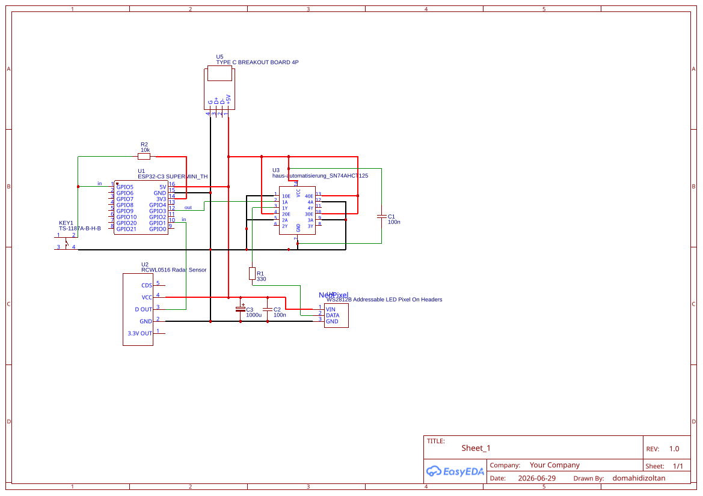

# ESP32-C3 WS2812B Motion Night Lamp

A MicroPython-based motion-activated night lamp built around an ESP32-C3, an RCWL-0516 microwave motion sensor, an SN74AHCT125D level shifter, and an 8x8 WS2812B LED matrix.

## Project

The lamp displays a randomly selected pixel-art sprite when motion is detected.

Main features:

- 8x8 WS2812B LED matrix
- RCWL-0516 motion detection
- SN74AHCT125D 3.3 V to 5 V logic-level shifting for the LED data signal
- Push-button brightness control
- Fade-in and fade-out effects
- Random sprite selection
- Configurable LED brightness limit
- Per-channel RGB calibration
- Serpentine LED matrix mapping
- X/Y image flipping
- Sprite files loaded at startup



## ESP32 Files

### `main.py`

Main MicroPython application.

The application handles:

- Motion detection
- Random sprite selection
- LED matrix output
- Brightness control
- Button handling
- Fade-in/fade-out
- Sprite loading
- RGB calibration

`main.py` contains the application logic and should normally not need to be edited for configuration changes.

### `config.py`

All user-adjustable application settings are located here.

Examples:

```python
LED_PIN = 3
MOTION_PIN = 1
BUTTON_PIN = 5

SERPENTINE = False
FLIP_X = True
FLIP_Y = True

FADE_IN_MS = 1000
FADE_OUT_MS = 3000
OFF_DELAY_MS = 10000

BRIGHTNESS_LEVELS = (1.00, 0.75, 0.50, 0.25)
MAX_LED_BRIGHTNESS = 0.10

CAL_R = 1.00
CAL_G = 1.00
CAL_B = 1.00
```

If the hardware or desired behavior changes, edit `config.py` and upload that file together with `main.py`.

## Sprite Files

Sprite files use the following format:

```python
C00 = "#000000"
C01 = "#FF0000"
C02 = "#FFD000"

SPRITE = [
    [C00, C01, C00, C00, C00, C01, C00, C00],
    [C01, C02, C02, C02, C02, C02, C01, C00],
]
```

The actual project sprites should contain an 8x8 `SPRITE` matrix.

Colors are stored in separate variables so they can be manually calibrated without changing the sprite layout. For example:

```python
C01 = "#FF0000"
```

can be changed to another HEX color while all references to `C01` remain unchanged.

Sprite files should use a two-digit numeric prefix followed by an underscore, for example:

```text
01_chick.py
02_mario.py
03_heart.py
```

The files are sorted by filename and loaded at startup.

## Image Conversion Tool

The project also includes a desktop Python tool for converting source images into LED-ready sprites.

### `image_to_hex.py`

The tool accepts square PNG or GIF images and:

1. Checks that the source image is square.
2. Resizes it to the configured target size, normally 8x8.
3. Uses nearest-neighbor resampling to avoid anti-aliasing.
4. Reduces the image to a configurable number of colors.
5. Disables dithering by default.
6. Saves the resulting indexed 8x8 PNG.
7. Generates a MicroPython sprite `.py` file.

Example:

```bash
python image_to_hex.py chick.png
```

The default output directory is:

```text
output/
```

The generated files are:

```text
output/chick_8x8.png
output/chick_sprite.py
```

### `image_to_hex_config.py`

Configuration for the image conversion tool.

Important settings:

```python
TARGET_SIZE = 8
PALETTE_SIZE = 8

RESAMPLE = "NEAREST"
DITHER = "NONE"
QUANTIZE_METHOD = "MEDIANCUT"
```

For example, to generate a 16-color sprite:

```python
PALETTE_SIZE = 16
```

The output sprite contains named color variables, making it easy to manually adjust the resulting palette after conversion.

## Requirements

### ESP32

- ESP32-C3 board
- MicroPython firmware
- `neopixel` support included with the firmware
- `main.py`
- `config.py`
- One or more numbered sprite files

### Image conversion tool

Python 3 with Pillow:

```bash
pip install pillow
```

## Typical Workflow

1. Create or obtain a square PNG/GIF pixel-art source image.
2. Adjust `image_to_hex_config.py` if needed.
3. Run:

```bash
python image_to_hex.py your_image.png
```

4. Inspect the generated 8x8 PNG.
5. If necessary, manually adjust the `CXX` values in the generated sprite file.
6. Copy the sprite file, `main.py`, and `config.py` to the ESP32-C3.
7. Adjust hardware or lamp behavior only through `config.py`.

## Project Structure

```text
main.py
config.py
image_to_hex.py
image_to_hex_config.py
README.md
```

Generated sprite files can be added alongside `main.py` and `config.py` on the ESP32.

